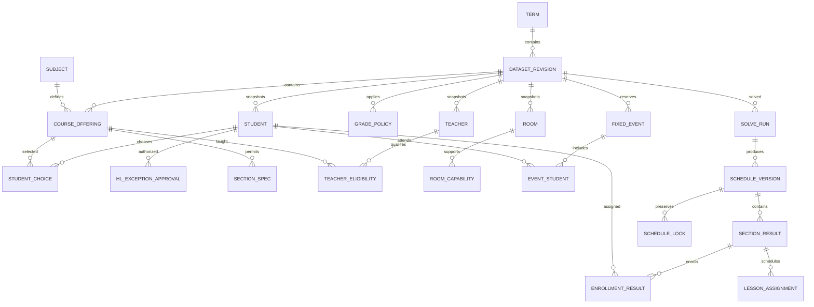
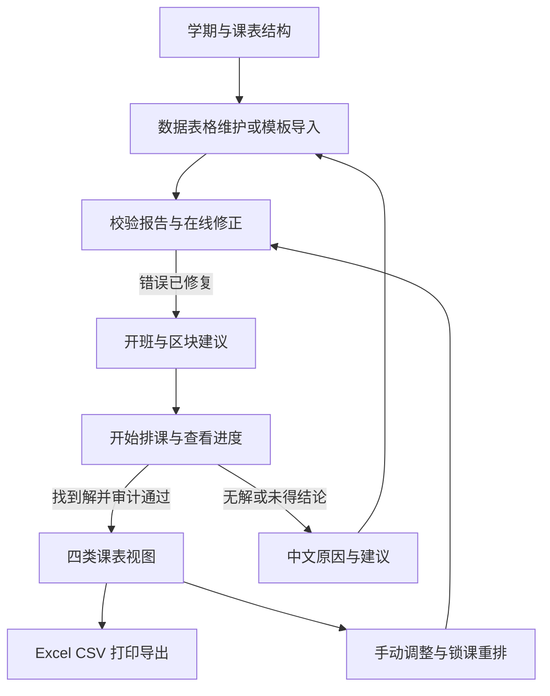

> 当前实现已按需求方新确认切换为灵活并行模式。此文保留v0.2初始设计历史；最新学校规则以[本轮规则变更](v0.2规则变更.md)和README为准。

# IBDP 自动排课系统设计文档

版本：设计修订稿 v0.2，已纳入需求方确认的严格六区块、年级规模、本机交付，以及十年级和四门 HL 特批规则。本文定义实现范围、数据契约、算法和验收方式，文中功能与性能指标仍是待实现、待验证的设计。

实现状态说明：当前已交付本机 MVP v0.1.0，实际功能、运行方式和限制以 [README](../README.md) 与 [验收记录](验收记录.md) 为准。本设计保留完整目标，不表示其中所有后续能力已实现。

系统面向每学期更新的学校数据，先交付可在普通笔记本离线运行的中文 Web 程序。核心采用 Python、OR-Tools CP-SAT、SQLite，页面采用 Flask 与 Jinja2。推荐使用区块分析引导统一约束求解，并由独立检查器确认结果，只有硬约束全部通过的课表才能标记为有效。

## 1 开始前需要明确的问题与默认假设

已确认的要求在下表明确标记，其余为实现默认值或待填写的数据。第 13 节区分已确认事项与后续可配置项。

| 问题或歧义 | 本设计的默认处理 | 影响 |
|---|---|---|
| 学生规模 | 已确认 11、12 年级各 6 个行政班、平均每班 22 人，即每级约 132 人、合计约 264 人；10 年级演示暂按同规模，三年级约 396 人 | 平均人数仅用于容量规划；实际以导入为准，不能把 6 个行政班当作 6 个教学班 |
| 只有学生选课，没有教学班名单时由谁分班 | 系统自动生成平行班并分配学生；同时支持老师预设和部分锁定 | 分班必须与排课联动，不能遗漏这一步 |
| 六区块是否属于学校不可更改的制度 | 已确认严格 6 区块全部覆盖：每名学生在每个区块恰好选入一个教学班，所有课次都在所属区块内 | 不允许跨区块溢出、跳过区块或自动增加第七区块 |
| 学科组是否必须对应同编号区块 | 不绑定；G1–G6 表示选课资格，B1–B6 表示时间组织 | 同一学科的平行班可进入不同区块 |
| 11、12 年级 HL 数量 | 已确认默认必须 3 HL＋3 SL；成绩达标且获校方批准者可选 4 HL＋2 SL | 特批按学生、学期登记；未获批准的 4 HL 不通过校验，始终恰好六科 |
| 10 年级差异 | 已确认仅两项课程政策差异：不分 HL/SL，且不开设 English A；其余结构与排课规则沿用 | 使用独立层级 `NONE`（网页显示“不分层”），不把十年级当作 SL，不运行 HL 数量或特批校验 |
| 双 G1 和 English A 如何处理 | 两门不同语言的 G1 可满足语言要求；English A 不自动表示已获得双语文凭 | 校验选课结构，不计算最终文凭资格 |
| G6 替代范围 | 按本项目默认仅 G3/G4，允许后台显式扩展 | 这是学校政策配置，不等于完整 IB 通用规则 |
| Mathematics、小语种的具体课程变体 | 显式记录 AA/AI、Language B/ab initio、Literature/Language and Literature 等；尚未确定的变体须由学校填写 | 不把名称相似、层级不同的课程合并 |
| 实验课比例和连堂是否必须 | 总课时、实验课时、必须连堂次数、期望连堂次数分别填写；不从“理科”名称推断实验比例 | 防止求解器把全部实验课变成理论课来获取可行解 |
| 教师是否可随每节课变化 | 一个教学班全学期固定一位教师，系统选择或老师指定 | MVP 不包含合教和轮换授课 |
| mini 班的“专用教室”是什么意思 | mini 班默认固定教师和固定物理教室；该教室在其他时段可供其他班使用，且能力必须匹配 | 若要求整周排他占用，需另行配置，不能默认为排他 |
| 不同类型实验室能否通用 | 按每间教室明确登记的能力判断；未登记则不可通用 | “四间实验室”不自动等于四间可做化学实验的教室 |
| 实验室容量小于普通教室容量 | 默认全班一起实验，不自动拆实验小组；整班容量须适合全部必需课型 | 普通教室能坐 18 人，不代表可让 18 人班进入 15 人实验室 |
| TOK/CAS/EE 的成员和占用 | MVP 导入已编好的固定活动及实际学生名单、教师、教室；后续增加 TOK 自动编组 | 固定活动标题或行政班标签不足以检查走班冲突 |
| 网站接入与“数据不出本机” | 已确认先交付本机运行版本，浏览器访问本机服务；网站接入留待后续 | 首版不依赖学校服务器或现成登录系统 |

IB 官方资料允许一般 DP 学生选 3 或 4 门 HL，艺术之外的第六门选择可包含额外的科学、个人与社会或语言课程。本校已明确采用更严格的“默认 3 HL，4 HL 须个人特批”政策；十年级执行本校不分层规则，不以正式 DP 的 HL 数量要求校验。[IB 课程结构](https://www.ibo.org/programmes/diploma-programme/curriculum/)

两门不同语言的 G1 可替代 G2 要求。双语文凭另有成绩和授课语言条件，不能仅凭 English A 的选课标记判断。[IB DP 通过与双语文凭条件](https://www.ibo.org/about-the-ib/what-it-means-to-be-an-ib-student/recognizing-student-achievement/about-assessment/dp-passing-criteria/)

## 2 需求理解与范围

### 2.1 产品交付

老师建立学期，配置周结构，通过 Excel 或网页维护课程、学生选课、教师、教室及固定活动，完成校验后启动排课。系统输出教学班名单和完整课表，提供学生、教师、教室、教学班四视图及 Excel/CSV 导出。下一学期复制规则和资源，再导入新的学生与选课即可使用。

系统初始不含真实学生、教师、班级；可提供可编辑的参考课程目录和空模板。演示数据仅在老师点击后载入独立演示学期，明确标注全部虚构，不能覆盖工作学期。

行政班只用于行政查询、批量选择活动成员和报表，不参与普通学科课程的排课单位定义。教学班定义为“年级 × 具体课程 × 层级 × 平行班”；层级在 10 年级固定为 `NONE`，11、12 年级为 `HL` 或 `SL`。三个年级不混班，共享的教师、教室必须联合求解。

10 年级与高年级共用六科结构、严格六区块、G6 替代、房间与教师约束等规则，只覆盖层级和 English A 可选性两项差异。其每科周课时仍由老师填写，不能因为不分层就直接套用 SL 或 HL 课时。

### 2.2 本期边界

MVP 实现 10—12 年级固定周课表、严格六区块全覆盖、年级政策与四门 HL 特批校验、自动或预设分班、自动或指定教师、类型化教室、必需课时与连堂、固定活动、导入校验、求解、四视图、导出、基本中文失败原因和独立硬约束检查。

后续实现手动调课与锁课重排、冲突核心及修复优化、完整软评分、A/B 双周、TOK 自动编组。数据结构在 MVP 预留这些能力；页面不会提前出现无法工作的按钮。

首版不实现成绩管理、IB 考试报名、最终文凭资格认定、代课通知、家校消息、自动修改学生选课、自动取消 mini 班、实验分组、跨校区交通排程或全年节假日补课。普通课程不包含体育；CAS 作为核心活动单独处理。未来新增特殊课程或跨学科资格规则时，先扩充校验政策，不能直接沿用不适用的六位置规则。

## 3 数据模型

### 3.1 版本与身份

所有排课输入归属一个学期数据版本 `dataset_revision_id`。学生、教师、教室使用稳定编码识别，姓名仅用于显示；同名不同编码不合并。版本内采用外键与唯一约束，禁止跨版本误引用。

一次求解绑定不可变输入快照、课程政策版本、参数和求解器版本。老师修改数据生成新版本，旧课表仍可查看，但标记“对应旧数据”。求解结果中的自动分班、教师分配归属对应方案，不覆盖其他方案。

### 3.2 主要关系

此图显示主链；禁排、导入来源和活动资源等辅助表见下表。

### 3.3 输入表

| 表 | 主要字段和约束 |
|---|---|
| `Term` | 学年、学期名称、起止日期、学校时区，默认 Asia/Shanghai |
| `DatasetRevision` | 学期、版本号、父版本、状态、创建时间、输入摘要；已用于求解的快照不可原地改变 |
| `CalendarConfig` / `CalendarSlot` | 周期长度、周型 A/B、星期、节次、起止时刻、是否可教学、能否与下一节连堂、上午/下午标签 |
| `SelectionPolicy` / `GradePolicy` | 政策版本、六科规则、适用年级、层级模式、默认 HL 数、特批 HL 数、G6 替代范围、双 G1 条件、禁开课程族、互斥组合；10 年级只覆盖两项政策差异 |
| `HLExceptionApproval` | 学生、学期/输入版本、状态（待批准/已批准/已拒绝/已撤销）、允许 HL 数 4、批准人、批准日期、依据备注；只有当前学期有效的已批准记录授予资格 |
| `Subject` | 课程编码、规范课程族（如 `ENGLISH_A`）、名称、学科组、课程变体、语言、允许层级、启用状态；新增课程必须填完整资格元数据 |
| `CourseOffering` | 开课编码、学科、年级、层级（`NONE/HL/SL`）、周期总课时、按周课时要求、实验课时、班容量、开班上下限、高负荷标记 |
| `LessonPatternRule` | 开课项目、理论/实验/艺术课型、必需课时、必须双节次数、期望双节次数、允许模式 |
| `LessonRoomRequirement` | 开课项目与课型、允许的房间能力组合；使用明确的“或/且”组表达，不依赖模糊名称匹配 |
| `Student` | 稳定学生编码、显示姓名、年级、行政班、是否参与排课；不收集与排课无关的身份证号等字段 |
| `StudentChoice` | 学生、开课项目；每名学生恰好六个不重复课程，层级从开课项目确定；10 年级为 NONE，11/12 按有效特批检查 HL 数 |
| `SectionSpec` | 教学班编码或候选编号、开课项目、容量、预设教师、预设房间、预设区块、是否强制开班 |
| `EnrollmentSpec` | 学生、预设教学班、是否锁定；只能关联学生已选的同年级同层级课程 |
| `Teacher` | 教师编码、姓名、每周负荷上限、可用状态 |
| `TeacherEligibility` | 教师、课程、层级、可教年级；明确登记 10/NONE、11/HL、11/SL 等资格，不能从高年级资格自动推定十年级安排 |
| `Room` / `RoomCapability` | 教室编码、名称、容量、物理房间身份；能力可包括普通教学、物理实验、化学实验、生物实验、画室、音乐 |
| `ResourceUnavailable` | 资源类别、资源编码、周型、时段、原因、是否允许提出解除建议；支持教师、学生、教室 |
| `FixedEvent` | 活动编码、TOK/CAS/EE/会议等类别、周型、开始节、长度、是否占用教学时间 |
| `EventStudent` / `EventTeacher` / `EventRoom` | 活动实际参与者和资源；教师关联记录是否计入周负荷；同一活动不重复扣除同一资源 |
| `BlockPolicy` / `BlockSlotSpec` | 固定 `mode=STRICT`、`block_count=6`、`student_full_coverage=true`、年级、预设区块时段或允许系统分配的时段；可显式要求各年级区块表同步 |
| `SoftPolicy` | 各软约束开关、权重、目标值、最后一节和周五下午等时段标记 |

能力属于物理房间：同一实验室即使同时有物理、化学两种能力，同一时段也只能容纳一个班。禁排是资源不可用；有真实参加者的固定活动是一次具体占用，二者不能重复计课时。

`NONE` 是明确的“不分层”业务值，不是漏填的空值；不同年级的开课记录分别维护。English A 限制依据规范课程族执行，覆盖别名以及 Literature / Language and Literature 等变体，不能通过改显示名称绕过。HL 特批由老师录入校方既有决定；成绩达标阈值尚未提供，MVP 不保存成绩或自动作批准判断。已获 4 HL 资格的学生仍可选择 3 HL；跨学期复制数据时不得自动沿用旧批准。

### 3.4 运行与审计表

| 表 | 主要字段和用途 |
|---|---|
| `ImportBatch` / `ImportRecord` | 文件摘要、模板版本、工作表、原始行号、标准化记录、在线修订记录 |
| `ValidationIssue` | 严重度、错误码、实体编码、来源行/字段、中文原因、修复建议、关联记录 |
| `SolveRun` | 输入版本、求解模式、时间预算、随机种子、线程数、软件版本、任务状态、求解状态、耗时、目标值与界 |
| `ScheduleVersion` | 运行、父方案、有效/有冲突草稿/旧数据状态、人工修改记录、独立检查结果 |
| `SectionResult` / `EnrollmentResult` | 实际启用的班、主区块、固定教师和房间策略、实际名单；属于方案版本 |
| `LessonAssignment` | 稳定课次 ID、班、课型、长度、起始时段、教师、房间、所属方案；连堂是一个跨两节的事件 |
| `ScheduleLock` | 来源方案、课次或分班、锁定字段、锁定值；支持时间、教师、房间、学生分班分别锁定 |
| `DiagnosticItem` / `RepairProposal` | 冲突约束、受影响实体、证据级别、建议变更、成本、验证状态、对应重算记录 |

锁定的课次保留稳定 ID。改变课时或连堂模式导致旧课次消失时，先报告锁定失效原因；不能通过重新编号悄悄丢掉锁。

## 4 导入模板与校验

### 4.1 Excel 模板

提供一个带中文填写说明、字段提示、下拉值和样例说明的 `.xlsx` 模板。模板下载为空数据版，虚构数据另外下载。复杂关系按多行记录，不要求老师输入 JSON 或逗号拼接的编码列表。

| 工作表 | 字段 |
|---|---|
| 填写说明 | 模板版本、必填/选填说明、编码规则、课时单位、填写示例 |
| 课表结构 | 周型、星期、节次、开始时间、结束时间、可教学、可连下一节、下午标记 |
| 课程目录 | 课程编码、名称、学科组、变体、语言、允许层级 |
| 开课与课时 | 开课编码、课程编码、年级、层级（十年级填“不分层”，高年级填 HL/SL）、周/周期课时、实验课时、班容量、班数限制、高负荷 |
| 课次要求 | 开课编码、课型、必须双节次数、期望双节次数、允许单节 |
| 教室需求 | 开课编码、课型、能力备选组编号、能力编码 |
| 学生 | 学生编码、姓名、年级、行政班 |
| 学生选课 | 学生编码、开课编码；每人六行，页面可用六个选择框编辑 |
| 四门 HL 特批（可选） | 学生编码、学期、批准状态、允许 HL 数、批准人、批准日期、依据备注；无有效已批准记录时仅允许 3 HL |
| 教师 | 教师编码、姓名、周负荷上限 |
| 教师资格 | 教师编码、课程编码、层级、年级 |
| 资源禁排 | 资源类别、资源编码、周型、星期、节次、原因 |
| 教室 | 教室编码、名称、容量 |
| 教室能力 | 教室编码、能力编码 |
| 固定活动 | 活动编码、名称、类别、周型、星期、起始节、连续节数 |
| 活动学生 | 活动编码、学生编码 |
| 活动教师 | 活动编码、教师编码、计入周负荷 |
| 活动教室 | 活动编码、教室编码 |
| 预设教学班（可选） | 班编码、开课编码、容量、指定教师、固定房间、主区块、强制开班 |
| 预设分班（可选） | 学生编码、班编码、锁定分班 |
| 区块时段（可选） | 年级、区块、周型、星期、节次 |

课程资格、区块时段和软权重也可在网页配置并随模板导出；本校严格六区块政策不提供切换弹性模式的选项。学生编辑页可登记和查看四门 HL 特批，导入与手工录入使用同一校验服务。标准 CSV 导入采用同名表文件组成的数据包，沿用相同编码与校验；不支持让一个 CSV 同时承载所有关系。

读取 `.xlsx` 的单元格值，不执行宏或公式；业务输入格中的公式要求先转为值，并报告具体位置。原始编码按文本处理，避免学号前导零丢失。输出时防止用户输入被 Excel/CSV 当作公式执行。

### 4.2 导入事务

下载模板 → 上传 → 解析到暂存区 → 展示数据概况与错误 → 在线修改或重新上传 → 重新校验 → 提交完整有效版本 → 启动求解。

完整替换当前草稿和按编码更新是两个明确入口。默认不静默合并、不因某张表缺失而清空原数据；替换之前显示增删改数量。导入失败保留现有有效版本。网页增删改走同一套校验服务；删除被引用的数据须先处理依赖。

每条错误保留工作表、Excel 原始行号、字段、实体编码、错误码和中文原因；跨行问题列出相关行。在线修改后保留原始来源与修订记录。错误清单可导出 `.xlsx` 和 CSV。

例如：`学生选课，第 24 行，S-DEMO-003：重复选择 PHY-G11-HL；与第 21 行重复。每门课程只能选择一次。`

### 4.3 分层校验

| 层次 | 检查 | 处理 |
|---|---|---|
| 格式 | 必填字段、整数、时间顺序、编码唯一、模板版本、非法公式 | 错误，不能进入排课 |
| 引用 | 学生/课程/教师/房间存在，年级层级匹配，时段有效 | 错误，定位所有相关行 |
| 选课 | 六门、无重复、年级层级规则、默认 3 HL 与有效 4 HL 特批、十年级 English A 禁选、组别结构、替代规则、互斥课程 | 错误，给出不满足的位置或政策；特批不能豁免其他要求 |
| 开班 | 预设名单合法、容量、开班上下限、mini 班保留、必需课型一致 | 错误或确定的资源不足 |
| 固定条件 | 固定活动、指定教师、禁排、房间与已有锁定的直接矛盾 | 列出冲突的活动、资源和时段 |
| 资源必要条件 | 无候选教师/房间、明确的负荷不足、时段窗口供给不足、必需连堂无合法起点 | 标记“输入完整，但资源条件已证明不可排”，禁止普通求解，允许查看修复分析 |
| 启发式风险 | 热门理科集中、区块图难着色、资源利用率高 | 警告，可继续求解；不冒充无解证明 |

只有严格必要条件才可在导入后直接判定资源不足。资源总小时数够用，也不表示可排：类型、容量、同时性和教师资格仍可能产生冲突。

### 4.4 选课合法性算法

对六门不同课程检查是否存在合法的“要求位置”匹配：语言一、语言二、G3、G4、G5、选修。普通路径中语言一由 G1 满足，语言二由 G2 满足；双 G1 路径中二者由不同语言的 G1 满足。选修默认来自 G6 或额外 G3/G4。每门课在该基础规则中仅占一个位置，六门必须全部被使用。

在匹配之外按年级校验：

- **11、12 年级：** 默认恰好 3 HL＋3 SL；若学生具有当前学期有效的已批准特批，可选择 4 HL＋2 SL。待批准、已拒绝、已撤销或其他学期批准均不授予四门 HL 资格。2 HL、5 HL 等组合始终拒绝；获得特批也不会增加第七门课程。
- **10 年级：** 六门课程全部为 `NONE`，跳过 HL 数量校验，禁止开设和选择 English A。出现 HL/SL、English A 或误填 HL 特批时，报告年级政策错误；不悄悄转为 SL，不自动把 English A 改成 English B。
- **所有年级：** 校验课程可开年级、层级、同科不重复和内容重叠禁选组合，展示选课路径和政策版本。其余规则共用，不另外推定十年级免修 TOK、减少科目或放宽区块。

例如：`学生选课，第 38 行，S-DEMO-011：选择了 4 门 HL、2 门 SL，但本学期没有有效的四门 HL 批准记录。请登记已有校方批准，或将选课调整为 3 HL＋3 SL。` 系统不为解决排课冲突自行降级课程或授予特批。

学校以后增加跨学科课程时，必须显式定义其覆盖规则和禁选关系，再扩展匹配；不能按课程名称猜测。公开资料不能替代 DP 协调员维护的完整学校课程政策。

## 5 教学班与区块分配

### 5.1 先确定开班候选范围

对每个“年级 × 课程 × 层级”汇总选课人数。设该课程在所有必需课型下可行的整班人数上限为 C；人数为 N 时，至少需要向上取整的 N/C 个班。C 同时受学校班容量、可用房间容量和课型限制影响，不能只看最大普通教室。

自动模式生成有限候选班，班内至少一人、不得超容量；预设模式遵守老师班数和名单；混合模式保留指定部分。默认无最小人数门槛，选课人数很少的课程仍必须开足课时。mini 标记可由学校指定，演示数据将少人数班显式标记。

为避免一开始产生过多变量，可从容量下限附近开始尝试，必要时扩展开班数。在未达到用户允许的上限之前，该搜索失败不能宣称原问题无解。若未设上限，自然上界是选课人数，且须受教师和课时资源约束；使用开班数量目标避免不必要的拆班。任何启发式上限必须写入运行记录。

### 5.2 学科图的作用与局限

建立按年级、课程、层级汇总的加权图：节点代表开课项目，边权为同时选择这两门课的学生数。图可显示哪些组合造成压力，并产生区块初始方案。

最终区块分配单位是教学班，学生选择某门课程的一个平行班。同一课程可有不同区块的平行班。否则，即使学生每人只选两门理科，物理＋化学、化学＋生物、生物＋物理三类选择也能使科目图形成三角形，不能将三个整科硬塞进两个区块。

图上的冲突数只能用作初始搜索代价；正式课表不允许残留任何学生冲突。每次改变分班后，要按真实名单重新评价教学班冲突。

### 5.3 严格六区块全覆盖

学校已确认使用严格六区块。对 10、11、12 年级均取 `B={B1,B2,B3,B4,B5,B6}`。每名学生的六个教学班恰好一一覆盖六个区块；每个班只属于一个区块，所有课次都必须落在该区块时段内。不存在跨区块溢出额度，也不以加大软惩罚的方式容忍违背。

同一学科的不同平行班可以分配到不同区块，但每个具体教学班不能跨区块上课。G1–G6 仍是课程资格分类，不强制对应 B1–B6；双理科学生通过不同区块的理科教学班覆盖其两个理科选择。

同一年级的一个时段最多归入一个区块。区块时段可由老师提供或由求解器分配，不预设六个区块等长。设区块 b 的可用节数为 `Q[g,b]=Σp k[g,b,p]`，则该块每个启用教学班的需求 `h[c]≤Q[g,b]`；六个区块的时段总量不得超过该年级可用教学时段。所有人参加的固定活动占用必须从可用于区块的时段中排除，其他活动按实际成员检查。

“全部覆盖”指每人每区块恰好一门课，不等于块内每个时段都必须上同样多的学科课。若同块 HL 需 6 节、SL 需 4 节，该块至少需要 6 个时段，SL 只排足规定的 4 节，余下时段显示为空闲/自习。系统不虚增 SL 课时；若学校另要求这些时段有人监管，须导入相应自习活动与资源。

三个年级默认使用同一铃声表，区块时段表按年级存储，并支持学校要求的跨年级同步锁定。严格六区块本身不自动推定三个年级的 B1 必须同时上课；尚未提供统一块表时，默认允许各年级区块错时，并始终在真实时轴上联合检查教师、教室。如果实际铃声不同，应改用真实起止时间重叠检查。

### 5.4 资源峰值的计算

区块分析输出每个时段的理论课、实验课、艺术课预计需求和可用资源。教师可行性采用实际资格关系，房间采用能力及容量匹配，不能只比较“教师总人数”和“实验室总间数”。

同一区块有多个理科班，不能据此直接认为每个时段都需要同样多的实验室：实验课可以错开，理论课可进入允许的普通教室。反过来，整周实验室小时数充足，也不能证明一个固定窗口内的峰值可满足。最终峰值从实际课次和房间分配计算。

## 6 算法选型与形式化约束

### 6.1 方案比较

| 方案 | 优点 | 局限 | 本项目选择 |
|---|---|---|---|
| 两阶段：先定分班/区块，再排时段资源 | 初始模型较小，区块结果好解释 | 早期分班和区块可能封死后续；一次失败不是全局无解，需回溯 | 用于初始建议和对照基准 |
| 完全统一 CP-SAT | 能联动分班、区块、教师、课次与房间，直接处理真实硬约束 | 变量多，必须剪枝、消除对称、控制搜索预算 | 作为最终可行性判定核心 |
| 区块引导的统一 CP-SAT | 图分析与分解产生热启动，统一模型可修正早期选择 | 仍需实测性能，不能预先保证所有输入都快速求解 | 推荐的实现方式 |

选择 CP-SAT 是因为本问题主要是离散分配、布尔冲突、整数容量和连续课次约束。核心求解模型与 Flask、数据库隔离，输入为规范化快照，输出为方案或有明确状态的诊断对象。

### 6.2 集合与变量

S 为学生，C 为候选教学班，T 为教师，R 为物理教室，P 为真实时段，B 为固定的六个区块。每个时段包含周型、星期和节次；即使三个年级区块表不同，P 仍全局统一。

- `active[c]`：是否启用教学班。
- `u[s,c]`：学生是否加入班；只为其已选、同年级同层级的候选班建立。
- `n[c] = Σs u[s,c]`：班级实际人数。
- `q[c,t]`：教学班是否由教师 t 固定执教。
- `z[c,b]`：班的主区块；`k[g,b,p]` 表示年级 g 的区块是否占该时段。
- `x[c,p]`：该班在该时段是否上课。
- 课次事件 e：所属班、课型、长度、候选起点、房间；连堂事件在整个持续区间使用相同教师和房间。
- `pattern[c,π]`：是否选择某个合法课次模式，如一次必需双节实验加若干单节理论；模式总课时与各课型课时必须一致。

连接条件为 `Σπ pattern[c,π] = active[c]`、`Σb z[c,b] = active[c]`。每个课次仅在其所属模式被选中时启用；启用课次恰好选择一个合法起点和一个房间，未启用课次没有任何资源占用。`x[c,p]` 等于该班启用课次对 p 的覆盖之和，并限制不超过一。所有课时需求均乘以 `active[c]`，未启用候选班不授课。

实现时对“属于这个班且该班此时上课”等合取建立辅助布尔量，不直接创建学生 × 班 × 时段 × 教师 × 教室的全笛卡尔积。数学定义以完整语义为准，具体编码可在基准测试后优化。

### 6.3 硬约束

| 编号 | 定义 |
|---|---|
| H1 选课覆盖 | 每个学生的每项选课，在匹配的候选班中 `Σc u[s,c] = 1`；未选的课程不得加入；11/12 默认 3 HL，4 HL 必须有有效特批；10 年级仅 NONE 且无 English A |
| H2 班级合法 | `u[s,c] ≤ active[c]`；启用班非空且不超容量；NONE/HL/SL、不同年级不混班；每个教学班同一时段最多一个课次 |
| H3 学生不重叠 | 对每个学生和时段，`Σc (u[s,c] AND x[c,p]) + 固定活动占用[s,p] ≤ 1`，并遵守学生禁排 |
| H4 固定教师 | 对每个班 `Σt q[c,t] = active[c]`，教师具备该课资格；指定教师时固定对应变量 |
| H5 教师不重叠 | 对每个教师和时段，`Σc (q[c,t] AND x[c,p]) + 固定活动占用[t,p] ≤ 1`；禁排时段不得授课 |
| H6 教师负荷 | 每周所有所教班的实际节数，加计入负荷的固定活动节数，不超过该教师当周上限；双节按两节计 |
| H7 房间 | 每个启用课次恰有一个房间，满足课型能力且容量不小于 n[c]，不得覆盖房间禁排时段；任一物理房间任一时段的课程与固定占用总数不超过一 |
| H8 课时 | 每个启用班在周期内及要求的各周排满规定节数；理论/实验/艺术各课型节数满足配置，既不能少排也不能多排；未启用班对应需求为零 |
| H9 连堂 | 必需双节次数达标；课次不能跨日、跨周、跨不可连的休息边界；同一连堂期间师生与房间一致 |
| H10 固定条件 | 固定活动、老师指定的分班/教师/房间、锁定字段必须保持；锁定相互矛盾须报告 |
| H11 六区块全覆盖 | 恰好六区块，每个启用班属于唯一一块；每名学生对每个 b 均满足 `Σc (u[s,c] AND z[c,b]) = 1`；每年级每时段最多属于一块；`x[c,p]` 只能发生于该班所属区块的时段，跨区块课次数必须为零 |

必须双节和优先双节分开建模。只有优先要求时，允许单节模式参与搜索，不能为方便实现把偏好偷偷改成硬约束。若课型课时为奇数，明确使用“双节＋单节”等合法模式。

### 6.4 软约束与评分口径

先满足全部硬约束，再改善软约束。网页允许配置非负整数权重，零表示关闭。每项同时报告原始违背数、分母、满足率和加权代价，避免只给一个难以解释的总分。

| 软项 | 代价定义 | 报告口径 |
|---|---|---|
| 实验、艺术优先连堂 | 实际额外双节数为 `max(0, 实际双节数 − 必需双节数)`；未达到期望的额外双节计罚，课次不重复计对 | `min(实际额外双节数, 额外目标数) / 额外目标数`；必需双节另列硬约束 |
| 一周均匀分布 | 每班每天超过目标日课时的节数，加未达到期望授课天数的缺口；日目标默认取周课时/教学天数向上取整，期望天数默认取教学天数与课次模式可安排课次数的较小值 | 分别报告 `1 − 超额节数/全部授课节数` 与实际覆盖天数/期望天数（最高为 1），两者等权汇总；列出扎堆的班与日 |
| 连续高负荷 HL | 在 11、12 年级允许连续的相邻节次中，不同高负荷 HL 课程紧邻的学生窗口数；默认以相邻两门作为惩罚起点 | `1 − 违规窗口数/可评价相邻窗口数`；同一双节内部不罚；10 年级显示“不适用”，不计入分母 |
| 最后一节与周五下午 | 落在不偏好时段的授课节数；重合时段默认只计一次，可配置优先级 | `1 − 不偏好节数/全部授课节数` |
| 平行班错开 | 同年级、同课程、同层级的平行班对在同一时段授课的次数 | `1 − 重叠班对时段数/最大可重叠班对时段数`；分母为各班对两班课时较小值之和 |
| 教师少空堂 | 教师每天首末工作事件之间，可教学且可用但无授课/固定活动的节数 | `1 − 空堂数/可评价内部时段数`；午休、禁排、会议不算空堂 |

分母为零时显示“不适用”，不伪造 100%。评分公式按政策版本保存。优化目标使用固定的归一化尺度转换为整数代价，避免使用随方案变化的分母扭曲优化；显示满足率单独按上表计算。

另外报告启用班数、人数分布、六区块逐学生覆盖情况、各区块时段与资源峰值，以及重排时改变的分班/教师/课次数量。区块漏选、重复或溢出均计入硬错误，不能用软分数抵消。新排课优先控制不必要的开班；重排优先保持未要求改变的已有安排，再优化用户软目标。各优先层的时间预算与是否证明最优均保存；未证明前层最优时，只能说明在当前前层值下继续优化。

### 6.5 求解流程与状态

1. 读取已验证输入快照，运行确定性必要条件检查。
2. 建立候选班、合法课次模式、教师和房间域；生成图分析与区块初始建议。
3. 先求硬约束可行解；热启动只提供提示，不冻结未锁定的选择。
4. 在严格六区块硬约束内，利用剩余预算减少无必要的开班并优化软目标；保存当前最好有效解。
5. 将结果交给独立检查器，检查通过后持久化为有效方案；失败按程序缺陷处理。
6. 无解或超时时按下表返回，不输出伪装成完整课表的部分解。

| 求解结果 | 中文状态与处理 |
|---|---|
| `OPTIMAL` | 已找到可行结果；只有目标最优性确已证明时，才称当前模型和目标下最优。纯可行性成功不等于软评分最优 |
| `FEASIBLE` | 已找到硬约束可行课表，可在独立检查后交付；软目标未证明最优 |
| `INFEASIBLE` | 当前完整输入及所选政策下已证明无解，进入中文诊断 |
| `UNKNOWN` | 本次搜索尚未得出结论；显示预算、已完成阶段，允许增加预算或调整搜索；不能显示“无解” |
| `MODEL_INVALID` | 模型构造或实现错误；保留本地日志和错误编号，不能归因于学校资源不足 |

任务取消、进程中断与上述求解状态分开保存。如果已有经独立检查的可行方案，取消后仍可保留该方案。状态含义依据 OR-Tools 官方定义；实现中关闭会混淆“精确最优”含义的非零最优间隙提前终止配置，或明确标注相应容差。[CP-SAT 求解状态](https://developers.google.com/optimization/cp/cp_solver)

## 7 无解诊断与最小松弛

### 7.1 先提供直接证据

无教师、无匹配房间、锁定课程撞课、某教师固定课时已超过其上限等问题，直接列出相关输入行、实体和时段。对资源窗口检查必需需求与可用供给；结论只覆盖实际证明的窗口和资源范围。

例如，若若干必须同一时段进行的实验课只能使用同一组房间，需求超过供给，则能给出该时段的房间缺口下界；这不自动证明按该下界增加房间即可解决整张课表。若只是初始区块方案峰值过高，报告的是“当前区块方案冲突”，允许先调整区块。

### 7.2 冲突核心

对可解释的业务约束设置标签，例如“教师 T-DEMO-02 周三禁排”“化学实验课最低数量”“课程开班上限”“课次 L-DEMO-018 锁定”。在无优化目标、单线程诊断副本中，使用 assumptions 提取足以造成无解的约束集合。

不是所有全局约束都能直接附加条件开关；诊断编码使用已验证支持的条件线性约束、明确的布尔连接或重建模型。学生不重叠、资源不重叠等基础规则保持为背景硬约束，报告需说明冲突核心是在这些背景规则下成立。

原始核心不保证最小。预算允许时逐条尝试删除并重新求解：删除后仍证明无解，就移除该条件；删除后证明可行，就保留该条件。只有最终集合自身已证明无解，且其中每个保留条件单独去掉后的剩余集合都已证明可行，才能称为“不可再删的冲突集”，仍不是约束数量最少的集合。遇到 `UNKNOWN` 保留“尚未完成缩小”的标记。[OR-Tools assumptions 与诊断说明](https://github.com/google/or-tools/blob/stable/ortools/sat/docs/troubleshooting.md)

预处理不能破坏诊断：若已把教师禁排时段从变量域删掉，在模拟解除禁排时必须重建候选域。不可直接在原剪枝模型上关掉一个开关就声称验证了解除方案。

### 7.3 修复动作与最小化对象

系统只对学校允许考虑的动作建立独立修复模型：

- 新增具有明确类型、容量和可用时段的完整物理房间。
- 解除某位教师的某个可协商禁排时段，或提出提高其周负荷上限的建议。
- 允许某门课程多开一个平行班、将不同平行班分布到现有六区块中的更多区块；每个具体班仍只属一块。
- 在学校允许的总课表内调整六区块各自时段，或建议放开某个可协商锁定；原数据中的锁仍保持。
- 理论课本来就允许进入普通教室时，重新分配房间；不得减少已规定的实验课时。

少选课程、学生撞课、容量超标、使用不合格教师或不安全的房间类型均不属于修复动作。严格六区块全覆盖、十年级两项政策以及四门 HL 审批不能由修复模型自动放宽；禁止增加第七区块、把十年级当 SL、自动批准四门 HL 或偷偷改变学生层级。任何建议都不自动修改学校数据。

默认按字典序最小化：先改变的业务政策项数，再按学校设定成本最小化新增房间、释放时段等动作量，最后改善课表质量。不同性质的资源没有天然统一成本，报告必须显示成本表与允许动作集合，并尽量提供几项代价不同的可行替代方案。

新增房间按整周期可用的实体建模，不能把每个时段的临时容量增量混称为“新增几间房”。如果只分析峰值扩容，报告单位必须写明“某类型房间在某时段的额外容量”。

### 7.4 报告的证据等级

| 标记 | 含义 |
|---|---|
| 确定错误 | 字段、资格、政策或固定条件直接矛盾 |
| 已证明无解 | 完整模型或严格必要条件证明当前输入不可行 |
| 资源下界 | 至少需要多少额外资源，尚未证明足够 |
| 候选建议 | 尚未获得完整可行解验证 |
| 已验证建议 | 应用该组变更的副本已生成并检查零硬冲突课表 |
| 已证明最小 | 修复模型已证明最优；仅限所列动作集合、成本定义和输入版本 |

中文报告包含问题摘要、冲突条件、受影响学生/教师/教室/课程、时段与来源行、证据等级、替代建议、变更量及重算结果。仅对完整通过复算的组合说“这样可以排”；某条建议只解决部分问题时明确说明。

## 8 系统架构与网页流程

### 8.1 技术栈

| 部分 | 选择与理由 |
|---|---|
| 语言 | Python，统一承载数据处理、约束求解、CLI 与 Web |
| 求解器 | OR-Tools CP-SAT，本地运行，无付费服务或外部 API |
| 数据库 | SQLite + SQLAlchemy，便于本机安装与备份；数据库迁移随版本提供 |
| 输入契约 | Pydantic 或等价明确类型的输入模型；集中校验枚举、范围与引用 |
| Excel | openpyxl；CSV 使用标准库；不要求安装 Microsoft Excel |
| Web | Flask + Jinja2，中文表单和普通表格；少量原生脚本用于状态刷新 |
| 运行 | Windows 兼容的本地服务进程；求解放入独立子进程，页面请求不阻塞数分钟 |
| 测试 | pytest、独立课表审计器、小实例穷举对照及验收数据集 |

依赖版本在实现阶段锁定并验证，README 给出支持的 Python 版本。运行时不使用 CDN、遥测或云 API；首次安装可联网下载依赖，另提供离线安装说明。开发环境、数据文件、导出和日志均在本机。

### 8.2 拟议模块划分

| 模块 | 职责 |
|---|---|
| `domain` | 实体、输入快照、政策、结果契约，不依赖 Flask |
| `storage` | 数据库表、迁移、事务、版本与备份 |
| `importers` | Excel/CSV/JSON 解析，来源行保留，模板版本升级 |
| `validation` | 字段、选课、引用、资源必要条件，网页与 CLI 共用 |
| `sectioning` | 候选班、预设班与名单、开班边界、分班建议 |
| `blocks` | 冲突图、严格六区块分配、逐学生全覆盖、区块容量与资源峰值报告 |
| `solver` | CP-SAT 模型、热启动、分层目标、预算、取消和状态 |
| `diagnostics` | 必要条件证据、冲突核心、缩核、修复优化与复验 |
| `audit` | 从输入快照与输出重新计算硬约束，不读取求解器内部变量 |
| `exporters` | 四视图共享数据投影、Excel、CSV、打印输出 |
| `services` | 导入、求解、手调、版本发布等用例；协调事务 |
| `web` | 路由、朴素模板、表单；无独立重型前端工程 |
| `cli` | 模板生成、演示、校验、求解、审计和导出入口 |
| `demo` / `tests` / `docs` | 合成生成规则、回归数据、验收与使用说明 |

拟议 CLI 操作是 `template`、`demo`、`validate`、`solve`、`audit`、`export`。输入支持规范化 JSON 或模板数据包；输出包括结构化课表、审计报告、诊断和所需导出文件。命令的最终安装方式与完整示例在实现后的 README 提供。

Web 和 CLI 必须调用同一服务层。后台任务仅传快照路径/标识，限制并发求解数量，完成后事务写回结果；进程崩溃可恢复为“已中断”，不会留下假成功状态。

### 8.3 页面流转

页面只提供必要功能：学期选择与设置、基础数据各实体增删改、导入校验与错误下载、求解参数与进度、四视图、版本及导出。区块建议附在排课页，无需另做复杂图形编辑器。

四视图按学生、教师、教室、教学班编码选择，表格以星期为列、节次为行，单元格显示课程、层级、区块、班号、教师和教室。10 年级层级显示“不分层”，11、12 显示 HL/SL。学生视图另列六区块对应的六个教学班。固定活动同步显示；空白格表示无排定活动，不自动添加自习教师或教室占用。

“一键演示”创建独立虚构学期并运行标准流程；不绕过校验器或独立审计器。

### 8.4 手动调整与锁课重排

老师选择课次，在下拉框中修改起点、教师或房间；双节作为整体移动。默认一个班固定教师，因此更换教师须作用于整个教学班并重新检查全部课次，不能只替换一节而违背模型。

每次修改先产生候选方案，同步重算受影响范围，再做完整硬约束检查。存在冲突时，列出具体人、房间、时间及相撞课次；可保留明确标记的冲突草稿，但原有效方案不被覆盖。只有审计通过的方案可作为有效课表导出；草稿导出必须显著标记。

锁定支持只锁时间、只锁教师/房间、锁学生分班或锁整个课次。重排使用当前方案作提示，并优先减少非锁定部分的变更。发布前逐项核对锁定值。

### 8.5 导出与本地数据

Excel 包含课次明细、教学班名单、四视图、参数摘要、硬约束审计和软评分；批量输出可按年级或对象筛选，避免强制创建数百张工作表。CSV 提供规范化课次明细、分班和各类视图投影，以 UTF-8 编码兼容中文。打印页提供重复表头、横向排版和版本信息。

所有视图和导出来自同一方案数据投影。长课次在网格中覆盖其占用节次，明细中保留一条课次及长度，避免导出重复计时。

默认只监听本机回环地址。文件保存在可配置本地数据目录，支持数据库一致性备份和整学期导出。上传、错误报告和日志不发送外部服务。未来接入学校网站时，采用学校可控服务器和校内访问控制，补齐登录、角色权限、CSRF、防越权及备份策略；不将本机开发服务直接暴露到公网。

## 9 A B 轮换与 TOK 扩展

周结构从开始就包含 `cycle_week`。固定周课表使用一个周型；双周模式使用 A/B 两个周型。课时可明确指定每周要求，或指定双周总量及每周上下限；不能把固定周复制两遍就称为完整支持轮换。

A/B 模式分别检查每周教师负荷，禁止用两周平均掩盖某周超限。固定活动、禁排、锁课和连堂都带周型；连堂不跨周边界。若允许 A/B 周不同节长，则以实际时长检查相应需求；MVP 默认教学节等长且工作量以节数计。

MVP 的 TOK 是已分组的固定活动。后续自动 TOK 编组增加组容量、候选教师、课时、成员覆盖和固定/可排时段，所有参与学生恰好加入规定数量的 TOK 组。TOK 分组独立于学科教学班和行政班，但占用同一学生、教师、房间资源。CAS、EE 的固定活动可直接复用该占用机制。

## 10 独立验证与验收

### 10.1 独立检查器

检查器从输入快照、名单和最终课次重新构造占用表，不能仅引用“求解器已返回成功”。逐项检查六门选课、六区块恰好覆盖、分班唯一性、年级与 NONE/HL/SL 分离、十年级 English A 禁开禁选、三门 HL 或有效四门 HL 特批、人数、教师资格及固定关系、全部资源重叠、禁排、周负荷、各课型课时、必需连堂、固定活动和锁定字段。

审计失败时不给方案贴“零硬冲突”标签，输出可定位的问题及本地运行记录。软评分也从结果独立计算，便于与求解目标核对。

### 10.2 核心测试

| 测试组 | 必须覆盖 |
|---|---|
| 学生 | 同时上两门课必报错；自动分班不漏选、不重复；高年级双理科与双 G1 合法案例；缺科、多科、同科 HL/SL 重复 |
| 年级与特批 | 10 年级六门 NONE 合法；10 年级 HL/SL、English A 及其别名均拒绝；11/12 的 3 HL 合法；无批准/待批/撤销/跨学期的 4 HL 拒绝，有效批准的 4 HL＋2 SL 合法；特批不能允许七科或绕过其他规则 |
| 教师 | 跨年级撞课、禁排、资格不符、超周负荷、固定教师不变；会议计负荷规则 |
| 房间 | 重叠、容量、错误实验类型、教室禁排；多能力房间不可重复占用；固定教室的 mini 班 |
| 课时与连堂 | NONE/HL/SL 分别按年级开课配置达标；理论与实验不互换；必需双节同日同房间、不可跨午休；奇数课时合法组合；不为填满区块虚增 SL 课时 |
| 区块与分班 | 科目三角冲突场景允许不同平行班分属不同区块；每生恰好覆盖全部六块；同一班跨区块、漏块、重复块均拒绝；禁止自动降为弹性或增加第七块；启发式失败不误报无解 |
| 固定活动与锁 | TOK 混合名单占用正确；锁定保持；相互矛盾锁定报告；重编课次不能丢锁 |
| 导入与版本 | 错误定位保留行号；失败导入不污染数据；同名不同编码不合并；旧结果不能当新数据结果 |
| 求解与诊断 | 可行/无解/超时/模型错误分别显示；缩核超时不伪称最小；修复建议须复验 |
| 视图与导出 | 四视图和 Excel/CSV 的课次、课时、参与者完全一致，双节展开不重复计量 |

对小规模模型用独立穷举或手工可核实实例对照可行性；对输出故意制造一次学生冲突、错房间、少课时等，检查审计器能检出。单元测试之外，还执行一次真实浏览器全流程验收。

### 10.3 合成数据

生成器固定随机种子并先构造合法的逐学生选课，再统计学科分布。参考人数只作为偏好，不能把互不一致的近似统计强行作为精确配额。数据包含双理科、11/12 的少量双 G1、小语种/艺术 mini 班、独立的 NONE/HL/SL 班、少量带虚构批准记录的 4 HL 学生、跨三个年级共享的教师和固定活动；10 年级无 English A。

至少提供：小规模可手查样例；单届约 132 人基准；11/12 合计约 264 人基准；按 10 年级同规模假设构造的三届约 396 人基准；实验室不足；教师禁排过多；非法选科与无批准四门 HL；锁定冲突；每生六科合法但严格六区块不可行的诊断样例。教学班数量由学生选课和容量实际生成并报告，不从行政班数量推定。原 120 人数据可保留作小规模回归，不作为学校全规模验收。

可行基准允许从一份合法隐藏见证生成资源与选课以确保确实有解，但测试时不将见证直接作为求解答案。另加入不同随机种子与独立扰动，避免只测容易的整齐六组数据。无解样例应有可核实的矛盾证据。

### 10.4 性能验收

目标是在记录了 CPU、内存和软件版本的普通笔记本上，以严格六区块、5 天 × 8 节进行测试：单届约 132 人初测预算 180 秒，11/12 两届约 264 人初测预算 300 秒，加入同规模十年级的约 396 人三届初测预算也先设 300 秒并单列结果。三届模式属于本机 MVP 功能范围，不能只用单届通过代替三届验收。预算是待实测的目标，不是现已验证的能力；10 年级真实人数以导入为准。

记录首次可行时间、最终时间、状态、班数、硬冲突数、软评分、内存峰值、随机种子和线程数。使用至少三个固定种子与不同紧张程度样例；基准不得把不可行数据误算为超时性能失败，也不能只选最简单数据。

单届、双届和三届分别报告首次可行时间，不因新规模更大而自动放宽严格六区块或省略十年级。若达不到目标，报告实测瓶颈并优化模型后复测。不承诺任意导入实例都能在分钟内求解或证明无解；超时须正常返回未决状态，并保留已有可行解。常规多线程求解不承诺逐次得到完全相同课表；复现实验另提供固定种子、单线程模式。

## 11 分阶段里程碑

| 阶段 | 后端交付 | 前端交付 | 完成条件 |
|---|---|---|---|
| M0 设计确认 | 已确认严格六区块、11/12 规模、本机交付、10 年级差异、四门 HL 特批；其余数据通过模板配置 | 无实现 | 关键政策记录在本版设计中 |
| M1 MVP 完整闭环 | 10—12 年级数据与政策、HL 特批、数据库与版本、模板、导入校验、自动/预设分班、自动/指定教师、严格六区块、硬约束求解、固定活动、独立审计、CLI、导出、基本中文错误 | 设置、CRUD/导入、特批记录、校验、排课、四视图、导出；普通表格与表单 | 三年级合成数据从导入到零硬冲突结果走通；核心硬约束测试通过；分规模性能实测 |
| M2 人工调整与锁定 | 方案版本、候选调整验证、不同范围锁定、最小变更重排 | 下拉修改、冲突列表、锁定复选框 | 调整不破坏原方案；锁定值全部保持 |
| M3 完整诊断与软目标 | 约束核心、缩核、修复优化与复验、六项可配置软评分 | 中文诊断表、建议对比、权重表单 | 三类故意错误场景得到正确状态与可解释建议；评分可复算 |
| M4 轮换与 TOK | A/B 周、逐周负荷、TOK 编组与排课 | 周型筛选、TOK 组表单 | 固定周功能不回退；A/B 和 TOK 专项测试通过 |
| M5 交付与接入准备 | 安装脚本、依赖锁定、备份恢复、CLI 和网页 README、基准报告 | 操作指引与打印页 | 新人在干净环境按说明完成安装及一次排课；目标 15 分钟，记录实测 |

MVP 不等待完整冲突核心算法才提供错误提示：格式错误、非法选课、直接资源不足、求解状态从第一版就必须有中文说明。后续阶段增强诊断精度，而不是修补只会返回 failure 的界面。

各阶段以可运行结果和验收证据推进，不为动效、主题、拖拽或复杂前端工程预留开发阶段。校内网站部署是否纳入 M5，取决于学校提供的接入环境与权限要求。

## 12 已确认要求与默认假设汇总

1. 首版针对一所学校、一个同时求解的学期，学校日历时区为 Asia/Shanghai。
2. 默认固定周，参考 5 天、每天 8 节；学校可改节次和时长。MVP 采用等长教学节，休息边界单独配置。
3. 已确认严格六区块全覆盖，每生每块恰好一个教学班；不溢出、不增加第七块。不同平行班可分属不同块。
4. 10—12 年级不混班，共享教师与教室全局求解；默认铃声一致，块表可按年级错时或被学校锁为同步；行政班不作为学科排课单位。
5. 每生恰好六门不同课程。11/12 必须 3 HL＋3 SL，只有本学期校方有效批准才允许 4 HL＋2 SL；系统不自行判断成绩或批准。
6. 默认 G6 可由额外 G3/G4 替代；双 G1 须不同语言；不判断最终双语文凭授予。
7. 课程变体与层级显式配置；未支持的特殊跨学科规则不得猜测为合法。
8. 总课时、实验课时、必须连堂均由学校按年级和层级填写；不把 HL 6、SL 4 当作不可变规则，也不把 10 年级 NONE 映射为 SL。
9. 默认全班一起实验，不自动生成实验小组；房间能力与安全容量是硬限制。
10. 每班固定一位教师；合教、临时代课和教师轮换不在 MVP 范围。
11. mini 班不得因人数少被取消或与其他课程/层级合并；默认固定一间匹配教室，房间非整周排他。
12. 空白教师禁排表示可用；固定活动须列实际资源。教师固定活动是否计负荷由显式字段决定，不能默认全部忽略。
13. 教师负荷以教学节计；双节计两节，A/B 模式分别检查每周上限。
14. 学生空堂允许；不自动排自习监督，除非学校以固定或可排活动提供需求。
15. 班数受学校明确上限约束；未设上限时至少受有限人数及实际资源限制；启发式限制不构成全局无解证明。
16. 软权重可调，默认先获得可行解，再控制不必要拆班和改善质量；评分口径随版本保存。
17. 锁课、禁排和指定资源均为硬约束；修复分析只在副本中模拟变更，不自动放宽。
18. MVP 的 TOK/CAS/EE 已有固定时段和成员；TOK 自动编组后续实现。
19. 不预装真实身份数据；合成数据采用独立学期，参考分布是近似权重。
20. 已确认先交付本机版本，运行时无外部 API；多人网站接入为后续事项。
21. 首次安装可下载开源依赖；离线部署另提供依赖准备步骤，不依赖付费许可证。
22. 性能是指定硬件、指定数据集下的待测指标；可行性、最优性和无解证明分别报告。
23. 已有有效方案不被失败导入、失败求解或有冲突手动调整覆盖；一切结果可追溯到输入版本。
24. 学期节假日、考试周和临时停课不在固定周 MVP 的自动展开范围；后续可新增日期级覆盖规则。
25. 已确认 10 年级只在两项课程政策上不同：不分 HL/SL、不开设 English A；其余沿用。不另行推定减少科目、取消核心活动或更改区块制度。
26. 已确认 11、12 各约 132 人。10 年级演示按相同规模构造，三届约 396 人属于容量规划假设；实际人数和教学班数始终以导入、分班结果为准。
27. 严格六块全覆盖不自动等于每位学生每个区块时段都上课；按实际课时安排，空闲时段不虚增学科课。

## 13 已确认事项与后续配置

需求方已确认严格六区块、11/12 各 6 个行政班且平均每班 22 人、先本机运行、10 年级不分层且无 English A，以及高年级默认三门 HL、四门 HL 需成绩达标后的校方批准。这些事项不再列为待确认。

以下信息可在后续配置或老师填写模板时补充，暂按本文默认值处理，不要求现在提交真实学生数据：

1. **时段与区块表：** 三个年级是否必须 B1 同时、B2 同时？若有现成统一表可导入锁定；未提供时允许年级块表错时。每节时长、午休和连堂边界也由校历配置。
2. **十年级数量与课时：** 其人数暂用同规模演示假设；真实人数、各门 NONE 课程周课时和实验课时由老师填写。
3. **分班：** 哪些名单、班数和指定教师必须保留？其余由系统在资源限制内自动安排。
4. **理科资源：** 各实验室能力、容量，课程最低实验课时、必须双节次数和理论课可用房间。
5. **课程细目：** 数学 AA/AI、语言变体、课程互斥组合；G6 替代默认仅 G3/G4。
6. **四门 HL 特批：** 老师记录批准人、日期与本学期批准状态；如以后需要自动按成绩判断，再补充学校明确的指标和审批流程，不在 MVP 擅自推定。
7. **固定活动与 mini 班：** TOK/CAS/EE 的成员与资源、教师负荷计入方式，以及 mini 班固定房间的具体编码。
8. **验收环境：** 学校笔记本配置与安装条件；按 132/264/假设 396 人分别记录严格六区块求解结果。

后续实现按 M1 的本机三年级闭环展开，再逐阶段增加手调、锁课、完整诊断与轮换能力。
